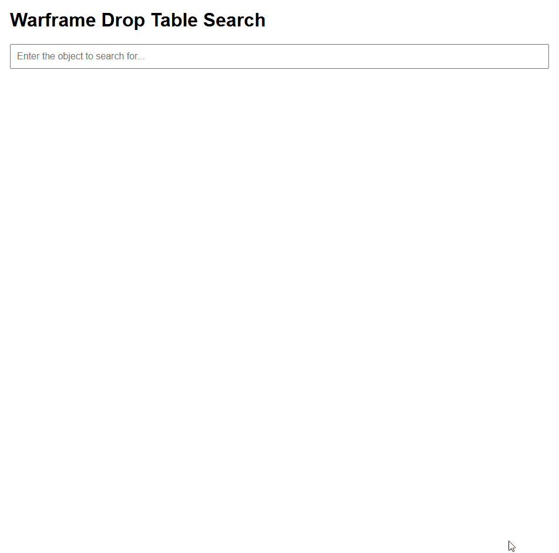

# Warframe Drop Search

https://theoooooo.github.io/warframe-drop-search/



I created this website to be able to search through the drop tables exposed on the [official Warframe drop table page](https://warframe-web-assets.nyc3.cdn.digitaloceanspaces.com/uploads/cms/hnfvc0o3jnfvc873njb03enrf56.html).

I was a bit tired of not being able to quickly find a drop across missions and drop tables, so I made myself a website to search them efficiently.

This is a fan-made tool, not affiliated with Digital Extremes.

## Features

### Search

- Search by loot (reward, mod, blueprint, resource) or by source (mission, enemy, bounty), from 3 characters
- Category drop-down menu with the number of results per category; picking a category with an empty search bar lets you browse it entirely
- Click any source or loot name in the results to search for it and list where it comes from
- AND conditions: the "AND" button of the search bar adds up to 5 extra terms that narrow the results, for example `Höllvania/Solstice Square (Defense)` AND `Relic` lists every relic this mission can reward
- Clear button inside the search bar
- Search history: click the search bar to get your 10 last searches, kept in a dedicated cookie (`wds_search_history`) and erasable from the same panel
- The address bar follows the current search (`?q=...&and=...&category=...`), so a search can be shared or bookmarked

### Saved searches

- Save the current search (text, AND conditions and category) with the bookmark button of the search bar
- Open, filter, rename and delete saved searches from the "Saved" button in the header
- Saved searches are kept in a dedicated cookie of your browser (`wds_saved_searches`) for 400 days, up to 20 searches. Nothing is sent to a third party

### Tracker

- Track a loot or a resource with the target button next to its name in the results, then set the quantity you still need (for example 3 Argon Crystal)
- Count down or up with the minus and plus buttons, either in the results or in the "Tracker" window of the header
- Stacks share one counter: "100X Oxium" and "200X Oxium" are both tracked as "Oxium"
- Relics can be tracked from the Relics table too, one counter per refinement; "Axi A22 Relic (Intact)" and "Axi A22 Relic" are the same item
- By default an item at 0 is marked as done and stays tracked; items can only be deleted from the "Tracker" window, one by one or with "Delete all"
- The "Remove tracked items at 0" switch of the settings (button left of the theme switch) removes an item automatically when it reaches 0. Settings are kept in a dedicated cookie (`wds_settings`)
- Click a tracked item to search where it drops
- Tracked items are kept in a dedicated cookie (`wds_tracked_items`) for 400 days, up to 30 items

### Results

- Compact, sortable tables (click a column header), paginated by 100 rows
- Color badges for loot rarity and for rotations A, B and C
- "Actual Chance" column: the drop chance of the source multiplied by the chance of the loot inside that drop table
- "Vault" badge next to relics that are no longer obtainable as a reward (see below)
- The Rotation column is hidden in categories that have no rotation (relics, sorties...)

### Other

- Dark and light themes
- Date of the last data update and site version in the header; click the version to see the version history
- "Changes" button: the days when the official drop tables changed, with the added (+) and removed (−) rows shown in the same tables as the search results. Pick a date in the calendar next to the title; days without any change cannot be selected

## Supported categories

Every loot category of the official page is supported:

- Missions
- Relics
- Keys
- Dynamic Location Rewards
- Sorties
- Cetus, Orb Vallis, Cambion Drift, Zariman, Albrecht's Laboratories and Hex Bounty Rewards
- Mod Drops by Source / by Mod
- Blueprint/Item Drops by Source / by Blueprint/Item
- Resource Drops by Source / by Resource
- Sigil Drops by Source
- Additional Item Drops by Source
- Relic Drops by Source

The parser recognizes a table by its structure and not by its name: a new category added to the official page is picked up automatically as long as it reuses a known table layout. A table with an unknown layout is skipped and reported as a warning in the data update job.

## Vaulted relics

A relic gets the "Vault" badge when it has a reward table in the Relics category but is not listed as a reward anywhere else (missions, bounties, keys, enemies). The list is computed when the data is extracted and stored in `data.json` under the `Vaulted Relics` key.

Only Lith, Meso, Neo and Axi relics can be flagged. Requiem and Vanguard relics are never flagged, because the official page does not list their sources under their exact name.

A relic that can only be bought (from Varzia for example) is flagged as vaulted, since it is not a mission reward.

## How it works

The site is made of static files only. There is no build step and no dependency, neither for the site nor for the data extraction.

```
data-retriever.py                         # downloads the official page and writes docs/data/data.json
tests/                                    # tests of the parser, the data history and the version numbers
docs/                                     # served as is by GitHub Pages
├── index.html
├── styles.css
├── script.js                             # search, filters, sorting, pagination, saved searches
├── theme.js                              # applies the color theme before the first paint
├── version.js                            # version history shown in the header
└── data/data.json                        # generated dataset
.github/workflows/daily-data-update.yml   # refreshes the dataset every day
```

The dataset is refreshed every day at 01:00 UTC by a GitHub Actions job.

## Run it locally

Python 3.10 or newer is the only requirement.

```bash
# Serve the site, then open http://127.0.0.1:8000/
python3 -m http.server 8000 --directory docs --bind 127.0.0.1

# Refresh the dataset from the official page
python3 data-retriever.py

# Run the tests
python3 -m unittest discover -s tests -v
```

Opening `docs/index.html` directly from the file system does not work: browsers refuse to load `data.json` outside of an HTTP server.

`data-retriever.py` also accepts `--input <file.html>` to parse a local copy of the official page and `--output <file.json>` to write somewhere else.

## Ideas for later

- Average duration of each rotation and mission, to estimate the time needed for a drop
